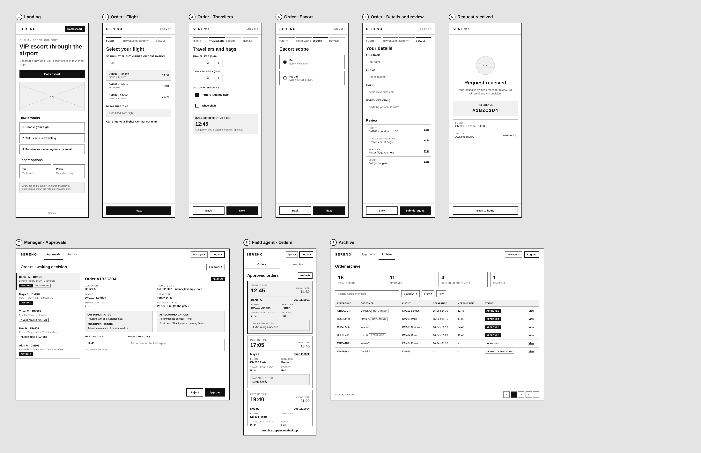
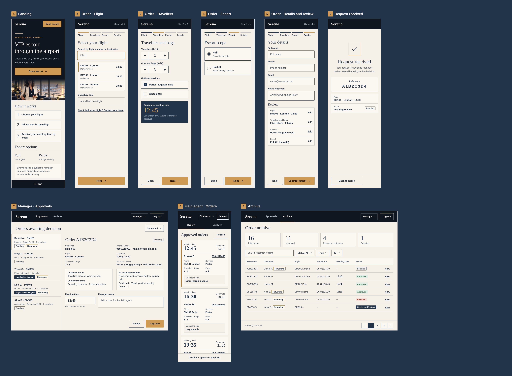
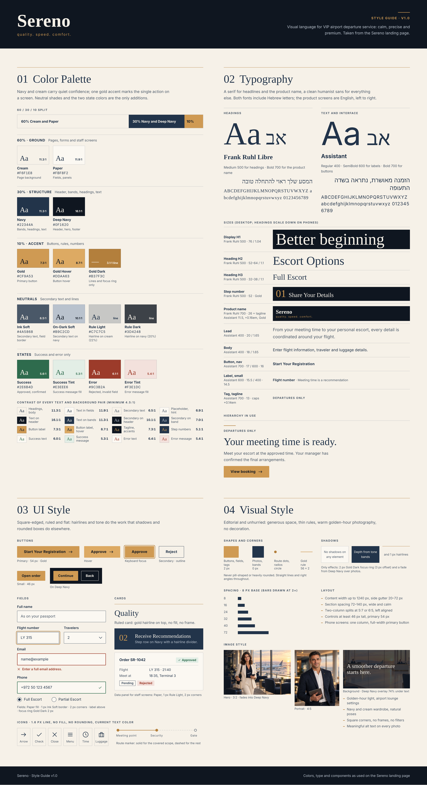

# DESIGN — Sereno

**מוצר:** Sereno (quality. speed. comfort.) — אוטומציה לשירות VIP בשדה התעופה, ליציאות בלבד
**תאריך:** 25.10.2026
**מקורות:** `product-10-definitions.md` (עשרת ההיבטים), `PRD.md`, ושלוש התמונות שבמסמך

המסמך מתאר איך המוצר נראה ואיך הוא מתנהג, בשני חלקים: **מסכים** ו-**Style Guide**. כל פרט במסמך נלקח מהתמונות או מה-PRD. מה שלא מופיע בתמונות לא הומצא, והוא רשום בנפרד בסוף חלק 1.

שפת הממשק היא אנגלית, משמאל לימין (לפי ה-PRD). לכן שמות הכפתורים והשדות במסמך מופיעים באנגלית כפי שהם נראים במסכים, וההסברים בעברית.

## שלוש התמונות

**Wireframes** — המבנה והפריסה של כל מסך, בשחור, לבן ואפור.

**Mockups** — אותם מסכים, מעוצבים לפי ה-Style Guide.

**Style Guide** — צבעים, גופנים, רכיבים ושפה חזותית.

---

# חלק 1: מסכים

## גדלי מסך

| מי | באיזה גודל |
|---|---|
| לקוח (דף נחיתה וטופס הזמנה) | טלפון ודסקטופ. בתמונות מוצגת רק גרסת הטלפון |
| נציג שטח | טלפון |
| מנהל | דסקטופ |
| ארכיון | דסקטופ בלבד. מי שנמצא בטלפון עובר אליו מקישור |

## רשימת המסכים

המסכים נקראים בשמות שב-PRD. בעמודה האחרונה מופיע שם המסגרת בתמונות.

| # | מסך (שם ב-PRD) | מי משתמש בו | מסגרות בתמונות |
|---|---|---|---|
| 1 | דף נחיתה ציבורי | לקוח | 1 Landing |
| 2 | הזמנה / רישום לקוח | לקוח | 2 Order · Flight, 3 Order · Travellers, 4 Order · Escort, 5 Order · Details and review, 6 Request received |
| 3 | אישור למנהל | מנהל | 7 Manager · Approvals |
| 4 | נציג שטח (המסך העיקרי) | נציג שטח | 8 Field agent · Orders |
| 5 | ארכיון | מנהל, נציג שטח | 9 Archive |

---

## 1. דף נחיתה ציבורי

**מטרה:** נקודת הכניסה של הלקוח. מסביר מה Sereno נותן, איך התהליך עובד, ומוביל לטופס ההזמנה. הלקוח לא צריך להתחבר.

**מה יש במסך (מלמעלה למטה):**

> **עודכן 22.11.2026 (החלטה של אסף, Milestone 6):** אזור הפתיחה נבנה לפי עיצוב חדש שאסף בחר, ולא לפי התמונות. הכותרת העליונה ואזור הפתיחה שלהלן מחליפים את מה שבתמונות. שאר המסך לא השתנה.

- אזור פתיחה כהה ברוחב מלא, בגובה המסך: ברקע סצנה מצוירת (SVG) של חלונות טרמינל בשקיעה, עם שמש, קו אופק, אורות מסלול ומטוס, ושכבת Deep Navy מתחת לטקסט.
- כותרת עליונה על גבי אזור הפתיחה: השם Sereno ומתחתיו "quality. speed. comfort.", קישורים "How it works" ו-"Escort options" (קופצים לחלקים בדף, בדסקטופ בלבד), וכפתור זהב "Start Your Registration".
- טקסט הפתיחה: "VIP DEPARTURE ESCORT" (זהב, אותיות גדולות), הכותרת "Your journey deserves a better beginning." (המילים "better beginning." באיטליק זהב), הפסקה "Enjoy a more seamless airport departure with Sereno. From your meeting time to your personal escort, the details are carefully coordinated around your flight.", כפתור זהב "Start Your Registration" עם חץ, וקישור "See how it works".
- בפינה התחתונה: קו זהב קצר, "QUALITY. SPEED. COMFORT." ו-"DEPARTURES ONLY".
- "How it works": שלושה צעדים ממוספרים: Choose your flight, Tell us who is travelling, Receive your meeting time by email.
- "Escort options": שתי אפשרויות, Full (To the gate) ו-Partial (Through security).
- תיבת הערה: "Every booking is subject to manager approval. Suggestions shown are recommendations only."
- כותרת תחתונה עם השם Sereno. אין מחירים.

**מה קורה במסך:** לחיצה על "Start Your Registration", בכותרת או באזור הפתיחה, מעבירה ל**הזמנה / רישום לקוח**, שלב 1. "See how it works" יורד לחלק "How it works".

---

## 2. הזמנה / רישום לקוח

**מטרה:** הלקוח יוצר הזמנה בעצמו, בארבעה שלבים קצרים. בסוף מופיע מסך שמאשר שהבקשה התקבלה.

**חלקים משותפים לארבעת השלבים:**
- כותרת כהה עם השם Sereno ומונה "Step X of 4".
- מחוון התקדמות בן ארבעה קטעים: Flight, Travellers, Escort, Details. שלבים שהושלמו בכחול כהה, השלב הנוכחי בזהב, שלבים שנותרו באפור.
- כפתורים בתחתית: "Back" (מסגרת) ו-"Next" (זהב). בשלב 1 יש רק "Next".

### שלב 1: Flight (Order · Flight)
- **מטרה:** לבחור את הטיסה מתוך הטבלה הפנימית, לא בטקסט חופשי.
- **מה יש:** כותרת "Select your flight". שדה חיפוש "Search by flight number or destination". רשימת תוצאות, רק טיסות עתידיות. לכל טיסה מספר, יעד, חברת תעופה, **תאריך** ושעה (למשל DM101 · London · Demo Airlines · Thu 10 Dec · 14:30). התאריך נוסף על מה שבתמונות, כי לאותו מספר טיסה יכולים להיות כמה תאריכים. שדה "Departure time" לקריאה בלבד עם הטקסט "Auto-filled from flight", שמציג תאריך ושעה. קישור "Can't find your flight? Enter it manually".
- **מה קורה:** הלקוח מקליד, בוחר טיסה מהרשימה, ושעת ההמראה מתמלאת לבד. "Next" עובר לשלב 2.
- **הזנה ידנית:** הקישור פותח, באותו שלב, שני שדות במקום הרשימה: "Flight number" ו-"Departure date", עם הטקסט "Our team will check your flight and get back to you." וקישור "Back to search". "Next" עובר לשלב 2 (ההזמנה עוברת למנהל לבירור, ראו PRD).

### שלב 2: Travellers (Order · Travellers)
- **מטרה:** מספר נוסעים, מזוודות ושירותים נוספים, ושעת מפגש מומלצת.
- **מה יש:** כותרת "Travellers and bags". שני בוחרי מספר עם כפתורי − ו-+: "Travellers (1–10)" ו-"Checked bags (0–10)". "Optional services": תיבות סימון "Porter / luggage help" ו-"Wheelchair". תיבה כהה "Suggested meeting time" עם השעה בזהב (12:45) והטקסט "Suggestion only. Subject to manager approval."
- **מה קורה:** שעת המפגש היא הצעה בלבד, והיא מחושבת לפי מספר הנוסעים והמזוודות. כשהמפגש נופל ביום שלפני ההמראה, התיבה מציגה גם את התאריך. כשהטיסה הוזנה ידנית, התיבה מציגה במקום שעה את הטקסט "We will confirm your meeting time after checking your flight." "Back" חוזר לשלב 1 והנתונים נשמרים. "Next" עובר לשלב 3.

### שלב 3: Escort (Order · Escort)
- **מטרה:** הלקוח בוחר את היקף הליווי. הבחירה שלו בלבד, והמנהל לא יכול לשנות אותה.
- **מה יש:** כותרת "Escort scope". שני כרטיסי בחירה עם כפתור רדיו: "Full — Escort to the gate" ו-"Partial — Escort through security". הכרטיס הנבחר מסומן במסגרת כחולה עבה.
- **מה קורה:** "Next" עובר לשלב 4, "Back" חוזר לשלב 2.

### שלב 4: Details (Order · Details and review)
- **מטרה:** פרטי קשר וסקירה אחרונה לפני שליחה.
- **מה יש:** כותרת "Your details". שדות עם תווית מעל: "Full name", "Phone", "Email", "Notes (optional)". אחריהם "Review": ארבע שורות, Flight, Travellers and bags, Services, Escort, ולכל שורה קישור "Edit". כפתורים "Back" ו-"Submit request".
- **מה קורה:** "Edit" מאפשר לתקן כל חלק לפני השליחה. "Submit request" שולח את ההזמנה למנהל ועובר ל"Request received". אם השרת מחזיר "Too many requests, please try again later", ההודעה מוצגת מעל הכפתורים בתיבת שגיאה (Error Tint), והנתונים נשמרים.

### Request received
- **מטרה:** לאשר שהבקשה התקבלה. ההזמנה עדיין לא מאושרת, וזה כתוב במפורש.
- **מה יש:** כותרת עם השם Sereno בלבד, סימן וי בריבוע, הכותרת "Request received", והטקסט "Your request is awaiting manager review. We will email you the decision." תיבת "Reference" עם מספר ההזמנה (A1B2C3D4). שורות "Flight" ו-"Status" עם תגית "Pending". כפתור "Back to home".
- **מה קורה:** "Back to home" חוזר לדף הנחיתה. ההחלטה של המנהל מגיעה ללקוח במייל, מחוץ למסך.

---

## 3. אישור למנהל

**מטרה:** המנהל בודק הזמנות, רואה את המלצות ה-AI, ומחליט. זה השלב האנושי היחיד בתהליך.

**גודל:** דסקטופ. המסך מחולק לשני צדדים.

**מה יש במסך:**
- כותרת עליונה כהה: השם Sereno, לשוניות "Approvals" (פעילה) ו-"Archive", תפריט תפקיד "Manager" וכפתור "Log out".
- כותרת "Orders awaiting decision" ומסנן "Status: All".
- **רשימת הזמנות (שמאל):** לכל הזמנה שם הלקוח, מספר הטיסה, יעד, זמן, מספר נוסעים ותגיות סטטוס: Pending, Returning, Needs clarification, Flight time changed. ההזמנה הנבחרת מסומנת בפס זהב.
- **פרטי ההזמנה (ימין):** כותרת "Order A1B2C3D4" ותגית סטטוס. Customer, Phone / Email, Flight, Departure, Travellers · Bags, Services · Escort. תיבות "Customer notes" ו-"Customer history", ותיבת "AI recommendations" עם שירותים מומלצים וטיוטת מייל. שדה "Meeting time" (עם הערה "Recommended 12:45"), שדה "Manager notes" ("Add a note for the field agent"). כפתורים "Reject" ו-"Approve".

**מה קורה במסך:**
- בחירת הזמנה מהרשימה מציגה את הפרטים שלה.
- המנהל יכול לשנות את שעת המפגש ולהוסיף הערה לנציג. שדה "Meeting time" כולל תאריך ושעה (בתמונות מופיעה רק שעה), בשעון ישראל. שעה שאינה לפני ההמראה מציגה מתחת לשדה את השגיאה "Meeting time must be before departure", בסגנון שגיאת שדה מה-Style Guide.
- "Approve" מאשר: ההזמנה עוברת למסך נציג השטח והלקוח מקבל מייל עם שעת המפגש. "Reject" דוחה, והלקוח מקבל מייל דחייה.
- היקף הליווי מוצג לקריאה בלבד.
- הלשונית "Archive" עוברת לארכיון.

---

## 4. נציג שטח (המסך העיקרי)

**מטרה:** הנציג רואה במקום אחד את כל מה שהוא צריך כדי לבצע את השירות בשדה התעופה, בלי לפנות לאף אחד.

**גודל:** טלפון.

**מה יש במסך:**
- כותרת כהה: השם Sereno, תפריט תפקיד "Field agent" וכפתור "Log out". מתחתיה לשוניות "Orders" (פעילה) ו-"Archive".
- כותרת "Approved orders" וכפתור "Refresh".
- רשימת כרטיסים, כרטיס לכל הזמנה מאושרת. בכל כרטיס: "Meeting time" בגדול, ומתחתיה התאריך בקטן, "Departure", שם הלקוח, מספר טלפון (מוצג כקישור), Flight, Services, Travellers · Bags, Escort, ובתיבה נפרדת "Manager notes" כשיש הערות. הכרטיס הראשון מסומן בפס זהב.
- בתחתית כל כרטיס כפתור משני קטן "Mark completed" (לא מופיע בתמונות).
- בתחתית קישור "Archive · opens on desktop".

**מה קורה במסך:**
- מופיעות רק הזמנות שהמנהל אישר. בגרסה הראשונה כל הנציגים רואים את כל ההזמנות המאושרות.
- אין עדכון בזמן אמת: "Refresh" מביא הזמנות חדשות ושינויים.
- "Mark completed" מבקש אישור באותו כרטיס, כדי למנוע לחיצה בטעות בטלפון: הכפתור מתחלף בשאלה "Mark this order as completed?" עם "Confirm" (ראשי) ו-"Cancel" (משני). אחרי אישור הכרטיס יורד מהרשימה, וההזמנה נשארת בארכיון.
- הקישור לארכיון פותח אותו בדסקטופ.

---

## 5. ארכיון

**מטרה:** לראות הזמנות קודמות והיסטוריית לקוחות. המנהל רואה את כל ההזמנות. ב-PRD ההרשאה של הנציג נקבעת לפי תפקיד.

**גודל:** דסקטופ בלבד.

**מה יש במסך:**
- אותה כותרת עליונה כמו במסך המנהל, עם הלשונית "Archive" פעילה.
- כותרת "Order archive".
- ארבעה כרטיסי סיכום: Total orders (16), Approved (11), Returning customers (4), Rejected (1).
- שורת סינון: שדה חיפוש "Search customer or flight", ותפריטים "Status: All", "From", "To".
- טבלה עם העמודות Reference, Customer (עם תגית "Returning" ללקוחות חוזרים), Flight, Departure, Meeting time, Status, וקישור "View". הסטטוסים בטבלה: Pending, Approved, Rejected, Needs clarification.
- בתחתית "Showing 1–6 of 16" ודפדוף בין עמודים (1, 2, 3).

**מה קורה במסך:** חיפוש וסינון מצמצמים את הרשימה. "View" פותח הזמנה. לשונית ההזמנות חוזרת למסך המנהל ("Approvals") או למסך הנציג ("Orders").

---

## הניווט בין המסכים

**לקוח:** דף נחיתה ← שלב 1 (Flight) ← שלב 2 (Travellers) ← שלב 3 (Escort) ← שלב 4 (Details and review) ← Request received ← "Back to home" ← דף נחיתה. בשלבים 2 עד 4 אפשר לחזור צעד אחורה עם "Back", והנתונים נשמרים.

**מנהל:** שתי לשוניות, Approvals ו-Archive. אפשר לעבור ביניהן בכל רגע. "Log out" מסיים את ההתחברות.

**נציג שטח:** מסך Orders בטלפון, עם קישור לארכיון שנפתח בדסקטופ. "Log out" מסיים את ההתחברות.

## מה לא מוצג בתמונות, ואיך בונים אותו

הפרטים הבאים נדרשים ב-PRD או נגזרים מהמסכים, אבל לא מעוצבים בתמונות.

**הכלל (הוחלט 10.11.2026):** מה שלא מעוצב בתמונות נבנה לפי ה-Style Guide (חלק 2), באותו קו עיצובי של המסכים המעוצבים: אותה כותרת כהה, אותם רכיבים, צבעים, גופנים ומרווחים. לא מוסיפים שפה עיצובית חדשה. הפירוט:

- **התחברות לצוות (`staff/login.html`):** כותרת כהה עם השם Sereno, כותרת "Staff sign in", שדות "Email" ו-"Password" עם תווית מעל, כפתור ראשי "Sign in" ברוחב מלא. פרטים שגויים מציגים מעל הכפתור תיבת שגיאה "Incorrect email or password". עובד בטלפון (נציג) ובדסקטופ (מנהל).
- **הזנת טיסה ידנית:** בשלב 1 של הטופס (ראו למעלה). אותם שדות כמו בשאר הטופס.
- **טיפול בחריגים במסך המנהל:** באזור הכפתורים בפרטי ההזמנה, במקום "Reject" ו-"Approve":
  - הזמנה "Needs clarification": תיבת פאנל עם המספר והתאריך שהלקוח הקליד והטקסט "Flight not found in our schedule", וכפתורים "Reject" (משני) ו-"Confirm flight missing" (ראשי). אחרי שמייל הבירור נשלח, במקום הכפתור הראשי מופיעה השורה "Clarification email sent".
  - הזמנה "Flight time changed": תיבת פאנל עם שעת ההמראה הקודמת והחדשה, ושעת המפגש החדשה המומלצת בשדה "Meeting time" שאפשר לשנות. כפתורים "Ignore" (משני) ו-"Approve change" (ראשי).
- **"Mark completed" במסך הנציג:** ראו למעלה.
- **פרטי הזמנה מלאים:** "View" בארכיון מוביל למסך שאינו מעוצב. פיצר Could, לא נבנה.
- **הודעות שגיאה בטופס:** ערך מחוץ לטווח, שדה חובה ריק, מייל לא תקין ושגיאת שרת. לפי מצב השגיאה של שדה ב-Style Guide: מסגרת Error והודעה מתחת עם סימן X.
- **רענון במסך המנהל:** כפתור קטן "Refresh" ליד מסנן הסטטוס, כמו במסך הנציג.
- **מיילים (הוחלט 18.11.2026, החל מ-Milestone 4):** המיילים מעוצבים לפי ה-Style Guide, ככל שתוכנות מייל מאפשרות: רצועה עליונה ב-Deep Navy עם השם Sereno בגופן הכותרות, גוף על רקע Cream או Paper, קו זהב קצר מעל הכותרת, פרטי ההזמנה כשורות של תווית וערך, ושעת המפגש מודגשת. רוחב עד 600px, עמודה אחת, בלי תמונות ובלי כפתורים. אם הגופנים לא נטענים, משתמשים בגופני גיבוי (serif לכותרות, sans-serif לטקסט). לכל מייל גם גרסת טקסט פשוט.
- **הודעת אזהרה על מייל שלא נשלח:** תיבה ב-Error Tint מעל הכפתורים בפרטי ההזמנה: "Decision saved, but the email to the customer was not sent."
- **גרסת דסקטופ של מסכי הלקוח:** אותו תוכן בעמודה אחת ממורכזת ברוחב של עד 560px. דף הנחיתה: אזור הפתיחה ברוחב מלא (עודכן 22.11.2026), ומתחתיו "How it works" ו-"Escort options" בשתי עמודות. **גרסת טלפון של מסך המנהל:** הרשימה והפרטים זה מתחת לזה.
- **סטטיסטיקות בארכיון:** מופיעות במסכים, אבל ב-PRD הן Could, מחוץ לגרסה הראשונה. תגית "Returning" נבנית במסך המנהל (FR-20). בארכיון היא Could (פיצר 35) ולא נבנית.

## עיצוב "אתרי" לטופס ולמסכי הצוות (עודכן 22.11.2026, החלטה של אסף, Milestone 6)

הטופס, דף הכניסה, מסך המנהל ומסך הנציג נבנו מחדש במראה כהה, בהמשך לדף הנחיתה החדש. המבנה והתוכן של כל מסך (השדות, הכפתורים, הטקסטים והסדר) לא השתנו. מה שהשתנה הוא המראה, והוא גובר על הצבעים שבתמונות ועל הכללים שבחלק 2 בכל מקום שהם סותרים:

- **רקע כהה:** הדפים ברקע Deep Navy, והטפסים והכרטיסים בכחול כהה (בערך `#131C28` לרקע ו-`#1A2636` לשדות ולכרטיסים). הטקסט בקרם, והטקסט המשני ב-On-Dark Soft.
- **פאנל השקיעה:** בדסקטופ, בטופס ההזמנה ובדף הכניסה, בצד שמאל פאנל קבוע עם סצנת השקיעה של דף הנחיתה (קובץ אחד, `public/assets/scene.svg`) וטקסט קצר: בטופס "Book your escort in four short steps." וארבע נקודות (יציאות בלבד, אישור מנהל, הצעות בלבד, ההחלטה במייל); בדף הכניסה "Welcome back to Sereno.". בטלפון הפאנל לא מוצג בטופס, ובדף הכניסה הוא פס קצר מעל הטופס.
- **כרטיס:** בדסקטופ הטופס, כרטיס הכניסה ופרטי ההזמנה במסך המנהל יושבים בכרטיס עם קו זהב עליון.
- **כפתורים ושדות מעוגלים:** כפתורים, שדות, תיבות סימון, כרטיסי בחירה, רשימת הטיסות ובוחרי המספרים עם פינות של 8px. תגיות, פאנלים וכרטיסים נשארים עם פינות של 2px.
- **קווים רכים:** מסגרות השדות על הרקע הכהה שקופות למחצה. הן מתבהרות במעבר עכבר, ובשדה פעיל או בבחירה מסומנת הן בזהב. תיבת סימון מסומנת וכפתור רדיו נבחר בזהב.
- **הודעות:** שגיאת שדה באדום בהיר (`#F0A898`), כדי שתיקרא על הרקע הכהה. תיבות השגיאה וההצלחה נשארות בצבעי ה-Style Guide.
- **תגיות במסך המנהל:** "Needs clarification" ו-"Flight time changed" בקרם עם טקסט כהה, כדי שיבלטו על הרקע הכהה.
- **מסך הנציג:** שעת המפגש בזהב, ותיבת "Manager notes" עם קו זהב בצד.
- **כותרת עליונה:** השם Sereno ומתחתיו "quality. speed. comfort.", כמו בדף הנחיתה (במסכי הצוות בטלפון בלי הסלוגן).
- **תנועה:** מעבר צבע קצר בכל מה שאפשר ללחוץ עליו, והחץ בכפתור זז מעט במעבר עכבר. גלילה רכה לקישורים בתוך דף הנחיתה. מי שביקש במערכת "פחות תנועה" לא מקבל את התנועה.

---

# חלק 2: Style Guide

האווירה: שירות VIP בשדה התעופה. רגוע, מדויק ויוקרתי. כחול כהה וקרם, מבטא זהב אחד, הרבה אוויר, קווים דקים וצילום חם בשעת שקיעה. הסגנון נלקח מדף הנחיתה של Sereno ולא נוספה שפה עיצובית חדשה.

## צבעים

חלוקה של 60-30-10: **60%** קרם ונייר (רקעים), **30%** כחול וכחול עמוק (מבנה, כותרות וטקסט), **10%** זהב (פעולה ראשית).

| שם | HEX | שימוש |
|---|---|---|
| Cream | `#F6F1E8` | רקע הדפים והמסכים |
| Paper | `#FBF8F2` | שדות, כרטיסים ופאנלים |
| Navy | `#22344A` | כותרות, טקסט, רצועות |
| Deep Navy | `#0F1620` | כותרת עליונה, אזור פתיחה, כותרת תחתונה |
| Gold | `#CF9A53` | כפתור ראשי, קו קצר, מספרי צעדים |
| Gold Hover | `#DDAA63` | כפתור ראשי בריחוף |
| Gold Dark | `#B37F3C` | קווים וטבעת פוקוס בלבד, לא לטקסט |
| Ink Soft | `#4A5868` | טקסט משני, מסגרת שדה, מציין מקום |
| On-Dark Soft | `#B9C2CD` | טקסט משני על רקע כהה |
| Rule Light | `#C7C7C5` | קו דק על רקע בהיר (בפועל כחול כהה ב-22% שקיפות) |
| Rule Dark | `#3D4248` | קו דק על רקע כהה (בפועל קרם ב-20% שקיפות) |
| Success | `#2E6B4D` | מאושר, הצלחה |
| Success Tint | `#E3EEE6` | רקע הודעת הצלחה ותגית "Approved" |
| Error | `#9C3B2A` | נדחה, שדה לא תקין |
| Error Tint | `#F3E1DC` | רקע הודעת שגיאה ותגית "Rejected" |

**ניגודיות:** כל זוג טקסט ורקע במוצר עומד ב-4.5:1 לפחות. הנמוך ביותר הוא 5.1:1 (זהב על כחול). זהב על קרם נמוך מדי לטקסט (2.2:1), ולכן Gold Dark משמש רק לקווים וטבעת הפוקוס.

## גופנים

| גופן | שימוש | משקלים |
|---|---|---|
| Frank Ruhl Libre | כותרות, שם המוצר, מספרי צעדים ושעת המפגש | 500 לכותרות, 700 לשם Sereno |
| Assistant | טקסט, כפתורים, שדות, טבלאות | 400 רגיל, 600 לתוויות, 700 לכפתורים |

שני הגופנים כוללים אותיות עבריות, אף שהממשק באנגלית. שם המוצר נכתב בגופן הכותרות, ללא סמל.

גדלים (דסקטופ):

| רכיב | גופן וגודל |
|---|---|
| כותרת ראשית (H1) | Frank Ruhl 500 · 76 / שורה 1.04 |
| כותרת משנה (H2) | Frank Ruhl 500 · 52 עד 64 |
| כותרת קטנה (H3) | Frank Ruhl 500 · 32 עד 38 |
| מספר צעד | Frank Ruhl · 52 · זהב |
| שם המוצר בכותרת | Frank Ruhl 700 · 26 |
| פתיח | Assistant 400 · 20 / 1.65 |
| טקסט | Assistant 400 · 18 / 1.65 |
| כפתור | Assistant 700 · 17 |
| ניווט | Assistant 600 · 16 |
| תווית שדה | Assistant 600 · 15.5 |
| טקסט קטן | Assistant 400 · 14.5 |
| תגית וסלוגן | Assistant 700 · 13, אותיות גדולות עם ריווח |

בטלפון הכותרות קטנות יותר: כ-30 עד 42 במסכי הלקוח, וכ-32 בכותרות מסכי הצוות.

## כפתורים ורכיבים

**כפתורים**
- **ראשי:** רקע זהב, טקסט Deep Navy, גובה 54 לפחות, פינות 2px, אפשר חץ בצד. בריחוף הרקע Gold Hover.
- **משני:** רקע שקוף, מסגרת כחולה דקה וטקסט כחול (למשל "Back" ו-"Reject").
- **קטן:** גובה 46 (למשל "Log out", "Refresh", "Book escort" בכותרת).
- **על רקע כהה:** מסגרת קרם דקה וטקסט קרם.
- **פוקוס מקלדת:** טבעת Gold Dark בעובי 2px במרחק 3px.

**שדות**
- תווית מעל השדה (Assistant 600, 15.5).
- רקע Paper, מסגרת Ink Soft בעובי 1px, פינות 2px, גובה 54 לפחות.
- מציין מקום ב-Ink Soft.
- בפוקוס: מסגרת כחולה וטבעת Gold Dark.
- שגיאה: מסגרת Error בעובי 2px והודעה מתחת עם סימן X.
- תקין: מסגרת Success בעובי 2px וסימן וי.
- שדה לקריאה בלבד (במסכים): רקע Cream, מסגרת Rule Light וטקסט Ink Soft.

**בחירה והזנה**
- בוחר מספר (Travellers, Checked bags): כפתור −, מספר בגופן Frank Ruhl, כפתור +.
- תיבת סימון: ריבוע בפינות 2px. מסומנת בכחול כהה עם וי קרם.
- כפתור רדיו: עיגול. נבחר עם נקודה כחולה, בתוך כרטיס. הכרטיס הנבחר במסגרת כחולה עבה.

**כרטיסים ופאנלים**
- **כרטיס עם קו:** קו זהב דק למעלה, בלי רקע ובלי מסגרת, כותרת בגופן כותרות וטקסט ב-Ink Soft (למשל "Full" ו-"Partial" בדף הנחיתה).
- **שורת צעד:** על רקע כחול, מספר זהב בגופן כותרות וקו מפריד דק.
- **פאנל נתונים:** רקע Paper, מסגרת Rule Light בעובי 1px, פינות 2px (הזמנות, סיכומים, תיבות הערות וכרטיסי סטטיסטיקה).
- **תיבת הצעת שעה:** פאנל כחול עם שעה בזהב (בשלב 2 של ההזמנה).

**תגיות סטטוס**
- Pending: מסגרת Ink Soft.
- Approved: רקע Success Tint וטקסט Success.
- Rejected: רקע Error Tint וטקסט Error.
- Needs clarification ו-Flight time changed: רקע כחול כהה וטקסט קרם (מופיע במסכים בלבד).
- Returning: מסגרת Gold Dark וטקסט כחול (מופיע במסכים בלבד).

**טבלאות, ניווט והתקדמות**
- כותרת טבלה על Paper עם קו כחול תחתון בעובי 2px, שורות עם קו Rule Light. שורה נבחרת מסומנת בפס Gold Dark.
- לשוניות על הכותרת הכהה: פעילה בטקסט קרם עם קו זהב תחתון, לא פעילה ב-On-Dark Soft.
- מחוון התקדמות: קטעים בעובי 4px. שהושלמו בכחול, נוכחי בזהב, נותרים ב-Rule Light.
- דפדוף: ריבועים בגודל 40 עם פינות 2px. העמוד הנוכחי בכחול כהה.

**אייקונים**
- קווים דקים בעובי 1.6px, בלי מילוי ובלי עיגול פינות, בצבע הטקסט.
- אייקונים בסגנון: חץ, וי, סגירה (X), תפריט, שעון, מזוודה, וחץ למטה בתפריטים נפתחים.
- סימון מסלול: קו עם עיגולים קטנים. קו מלא למה שמכוסה וקו מקווקו לשאר.

## פינות וצורות

- כפתורים, שדות, פאנלים ותגיות: פינות 2px בלבד. אין צורות עגולות או מעוגלות מאוד.
- **עודכן 22.11.2026 (החלטה של אסף):** כפתורים ושדות עם פינות של 8px בכל האתר. ראו "עיצוב 'אתרי' לטופס ולמסכי הצוות" בסוף חלק 1.
- תמונות ורצועות צבע: פינות 0, בלי מסגרת.
- עיגול רק בכפתורי רדיו ובנקודות סימון המסלול.
- קו זהב קצר (56 על 2) מעל כותרות באזורי פתיחה.

## מרווחים

- בסיס של 8px: 8, 16, 24, 32, 40, 72.
- מרווח בין אזורים בדף: 72 עד 140.
- רוחב תוכן עד 1240, שוליים בצדדים 20 עד 72.
- שני עמודות בדסקטופ ביחס 5 ל-7, מיושרות לשמאל.
- אזורי לחיצה גבוהים מ-46 לפחות. הכפתור הראשי 54.
- בטלפון: עמודה אחת, וכפתור ראשי ברוחב מלא.

## צללים והדגשות

- אין צללים. עומק נוצר ברצועות צבע (Deep Navy, Navy, Cream) ובקווים דקים בעובי 1px.
- **עודכן 22.11.2026:** הטופס ומסכי הצוות כהים (ראו סוף חלק 1). עדיין אין צללים.
- שני אפקטים בלבד: טבעת פוקוס Gold Dark (2px, מרחק 3px), והדהיית תמונה לכחול עמוק בקצה.
- תמונת רקע עם טקסט: שכבת Deep Navy בשקיפות 74% מתחת לטקסט.

## סגנון תמונות

- צילום חם בשעת שקיעה, בסביבת טרמינל ושדה תעופה.
- בגדים בגוני כחול וקרם, תנוחות טבעיות.
- פינות ישרות, בלי מסגרת ובלי פילטרים.
- יחסים: 3:2 לתמונת פתיחה, 4:5 לדיוקן, ותמונת רקע רחבה עם שכבה כהה.
- לכל תמונה טקסט חלופי משמעותי.

## נגישות בסיסית

- ניגודיות של 4.5:1 לפחות לכל טקסט, כמפורט למעלה.
- תווית גלויה לכל שדה בטופס.
- טבעת פוקוס לניווט במקלדת.
- טקסט חלופי לתמונות.
